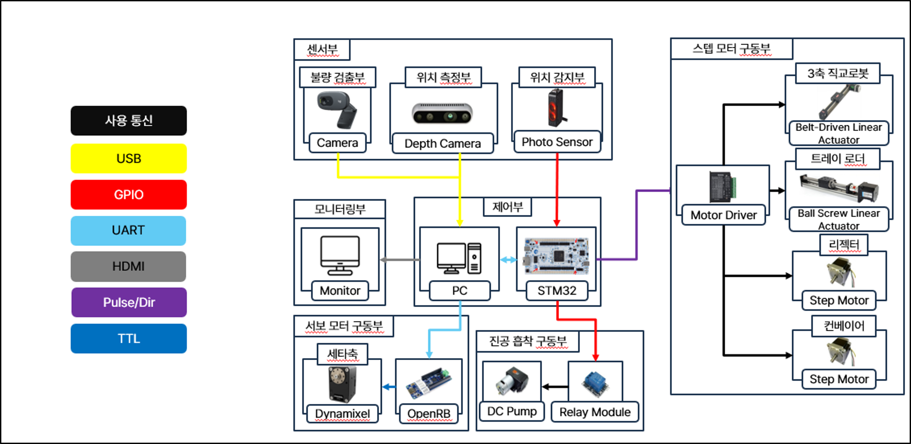
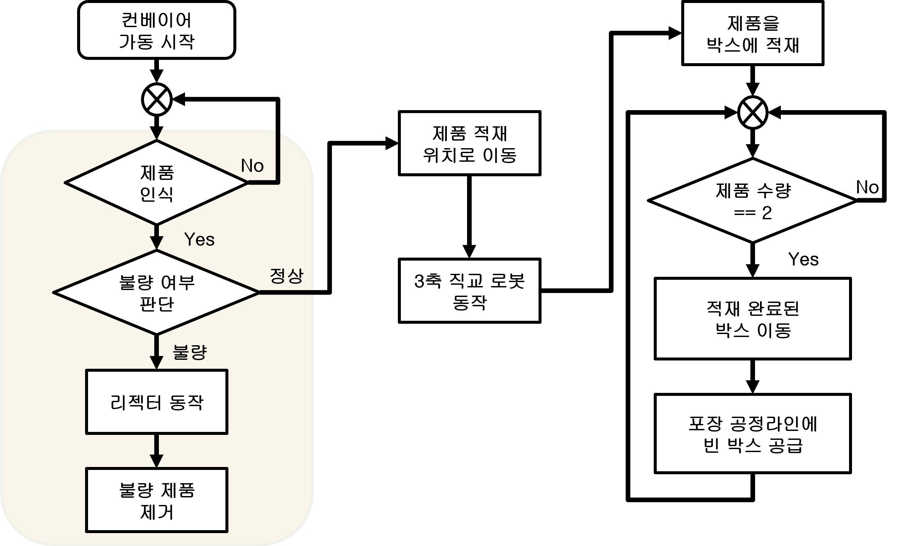
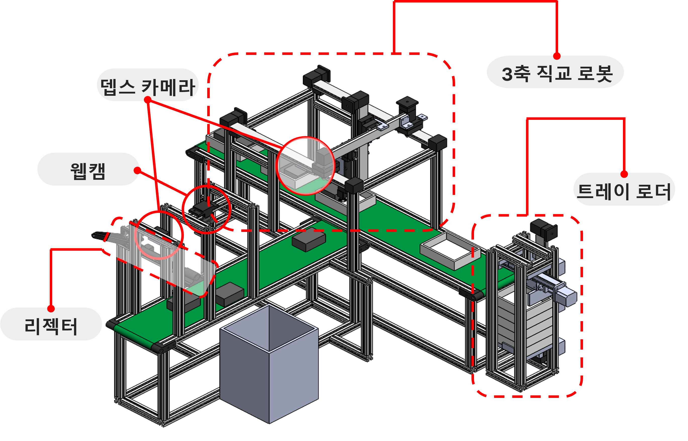
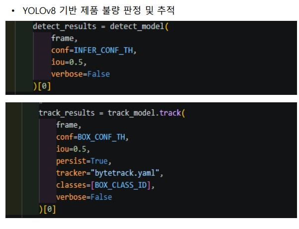
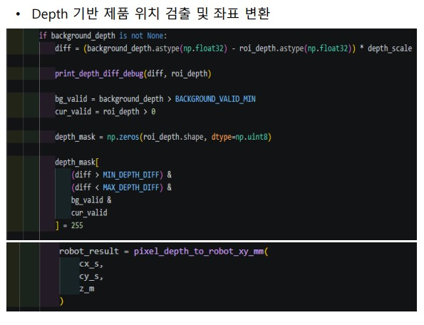
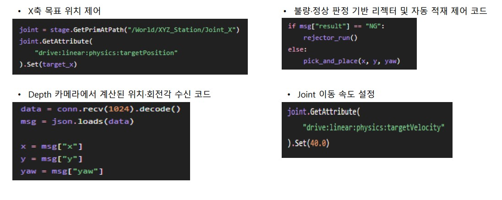
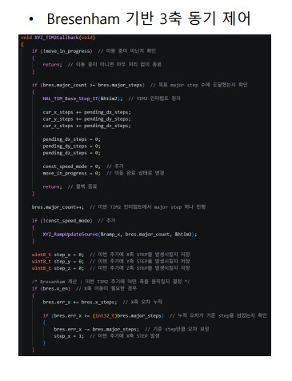

# Virtual to Real

### 디지털 트윈 기반 물류 적재 공정의 AI 동작 최적화 및 검증

**Virtual to Real: AI-Based Motion Optimization and Validation of Digital Twin-Based Logistics Loading Processes**

> **2026 한이음 드림업 | 프로젝트 번호: 26_HC278**  
> AI 비전 검사 · 이동 트레이 추적 적재 · 3축 직교 로봇 · 실물–디지털 트윈 연동

---

## 💡 1. 프로젝트 개요

### 1-1. 프로젝트 소개

- **프로젝트명:** Virtual to Real : 디지털 트윈 기반 물류 적재 공정의 AI동작 최적화 및 검증
- **프로젝트 번호:** 26_HC278
- **프로젝트 정의:**  AI 비전과 디지털 트윈 기술을 활용하여 물류 제품의 검사·분류·적재 공정을 자동화하는 시스템입니다. YOLOv8 기반 불량 판별과 리젝터 제거, Depth 카메라 기반 위치·회전각 인식을 통해 3축 직교 로봇이 정상 제품을 자동 적재합니다. 또한 이동 트레이의 위치를 추적하고, NVIDIA Isaac Sim과 실제 공정을 연동하여 시스템 동작을 시각화하고 검증합니다.
### 1-2. 개발 배경 및 필요성

인건비 상승과 생산·물류 효율화 수요의 증가에 따라 제품 검사, 이송, 분류 및 포장 공정의 자동화 필요성이 확대되고 있습니다. 동시에 제조·포장 현장의 반복 작업과 기계 끼임·협착 등 위험 작업을 줄이기 위해서는 사람의 개입을 최소화한 공정 운영이 필요합니다.

이에 본 프로젝트는 **AI 비전 기반 불량 판독 → 불량 제거 → 정상 제품 위치·회전각 인식 → 로봇 자동 적재 → 트레이 공급·이송**의 흐름을 통합하고, 실제 설비와 시뮬레이션 환경 사이의 상태를 연계하여 공정 동작을 확인할 수 있도록 구성하였습니다.

### 1-3. 프로젝트 특장점

- **AI 비전 기반 품질 검사:** YOLOv8과 ByteTrack을 활용하여 제품의 정상·불량 여부를 실시간으로 판별하고, 객체 추적 및 ROI 기반 검사로 판정 안정성 확보
- **불량 제품 자동 분류:** AI 검사 결과에 따라 리젝터를 구동하여 불량 제품을 자동 배출하고 정상 제품만 후속 적재 공정으로 이송
- **Depth 기반 정밀 위치 인식:** Depth 카메라로 제품의 3차원 위치 및 회전각을 추출하고, 로봇 좌표계로 변환하여 자동 적재에 활용
- **실시간 다축 모션 제어:** STM32와 FreeRTOS 기반으로 제어 작업을 분리하고, Bresenham 다축 보간 및 S-curve 가감속을 적용하여 3축 직교 로봇의 이동 제어
- **트레이 로더 기반 자동 공급:** 적재 상태에 따라 트레이 로더를 구동하여 빈 트레이를 자동 공급하고, 적재 완료 후 다음 트레이를 준비해 연속적인 포장 공정 구현
- **실물–디지털 트윈 연동:** 실제 센서·비전·제어 데이터를 NVIDIA Isaac Sim과 연동하여 공정 동작을 시각화하고 로봇 이동 경로 및 장치 간 간섭 검증
- **통합 공정 모니터링:** 실시간 검사 영상, 정상·불량 수량, 최근 판정 이력, 컨베이어 구동 상태 및 디지털 트윈 화면을 통합 GUI에서 확인

### 1-4. 주요 기능

| 구분 | 주요 기능 | 설명 |
|:---|:---|:---|
| 제품 검사 | AI 비전 판독 | 웹캠과 YOLOv8을 이용하여 정상·불량 제품 구분 |
| 불량 제거 | 리젝터 구동 | 불량 판정 결과에 따라 리젝터 작동 후 복귀 |
| 위치 인식 | Depth 기반 좌표 추출 | 정상 제품의 중심 위치·깊이·회전각을 계산하여 로봇 좌표로 변환 |
| 자동 적재 | 3축 직교 로봇 | 진공 흡착 및 그리퍼 회전각 보정 기반 Pick & Place |
| 이동 트레이 추적 | 센서·속도 기반 위치 계산 | 포토센서 기준 위치 및 속도·시간으로 현재 위치 추정과 오차 보정 |
| 추적 적재 | 목표 좌표 보정 | 트레이 이동을 고려한 위치 보정 및 로봇 동기화 적재 |
| 트레이 공급 | 트레이 로더 | 적재 상태에 따라 빈 트레이 자동 공급 |
| 실물–가상 연동 | NVIDIA Isaac Sim | 장치 상태와 제어 데이터를 연계한 공정 동작 시각화 |
| 모니터링 | 통합 사용자 UI | 영상, 판정 결과, 장비 구동 상태 및 이력 확인 |

### <알고리즘 시나리오>

① 컨베이어를 구동하여 제품을 이송한다.  

② 검사 공정에서 웹캠을 통해 제품을 인식하고 정상·불량 여부를 판별한다.  

③ 불량 제품으로 판정되면 리젝터를 동작시켜 제품을 제거한다.  

④ 정상 제품은 Depth 카메라를 이용해 위치 좌표와 회전각을 추출한다.  

⑤ 추출한 위치·회전각 정보를 기반으로 3축 직교 로봇이 제품을 흡착하여 트레이에 적재한다.  

⑥ 박스 내 제품 수량을 확인하고, 설정 수량에 도달할 때까지 적재 동작을 반복한다.  

⑦ 적재가 완료되면 트레이 로더를 구동하여 완료된 트레이를 이송하고 빈 트레이를 공급한다.  

⑧ 실제 공정 데이터는 Isaac Sim 및 UI와 연동하여 공정 상태를 실시간으로 모니터링한다.
### 1-5. 기대 효과 및 활용 분야

- **기대 효과:** 검사·선별·적재 공정의 통합 자동화, 반복·위험 작업 축소, 이동 중 적재를 통한 공정 연속성 확보, 실제 공정의 시각화와 검증 지원
- **활용 분야:** 제조·물류 자동화, 스마트 팩토리, 제품 품질 검사, 로봇 기반 Pick & Place, 디지털 트윈 공정 검증 및 교육

### 1-6. 기술 스택

| 분야 | 기술 및 장치 |
| --- | --- |
| 프로그래밍 | Python, Arduino C/C++, STM IDE C |
| AI 비전 | YOLOv8, ByteTrack, OpenCV |
| 영상·위치 센싱 | 웹캠, RealSense Depth Camera, 포토센서 |
| 로봇·구동 | 3축 직교 로봇, 스텝모터, 진공 흡착 그리퍼, 리젝터, 트레이 로더, 컨베이어 |
| 임베디드 제어 | STM32 Nucleo, OpenRB, Dynamixel |
| 디지털 트윈 | NVIDIA Isaac Sim, USD Prim, PhysX Joint |
| 데이터 통신 | TCP/IP, UART, GPIO |
| 운영 및 모니터링 | 중앙 제어 PC, 통합 GUI |

---

## 👥 2. 팀원 소개

| 구분 | 팀장 | 팀원 1 | 팀원 2 | 팀원 3 | 멘토 |
|:---:|:---:|:---:|:---:|:---:|:---:|
| **담당 역할** | AI 비전 개발 및 총괄 | 하드웨어 설계·제작 | 디지털 트윈 구현 | 임베디드 시스템 개발 | 기술 자문 및 지도 |

## 🛠️ 3. 시스템 구성도

### 3-1. 하드웨어 구성도

*Fig. 1. Hardware Block Diagram*

### 3-2. 소프트웨어 플로우차트

*Fig. 2. Software Flowchart*

  

### 3-3. 하드웨어 구성

- **검사부:** 웹캠, 검사 컨베이어, 리젝터
- **위치 인식부:** RealSense Depth 카메라
- **적재부:** 3축 직교 로봇, 진공 흡착 그리퍼, 포장 컨베이어
- **트레이 공급·추적:** 트레이 로더, 포토센서
- **제어부:** STM32 Nucleo, OpenRB, 모터 드라이버, 중앙 제어 PC
- **디지털 트윈:** Isaac Sim에서 USD Prim으로 객체를 구성하고 PhysX Joint로 동작 축을 설정

*Fig. 3. Overall Hardware Configuration*
  

### 3-4. 핵심 알고리즘: 이동 트레이 추적 적재

1. **트레이 감지:** 포토센서로 트레이의 초기 기준 위치 및 감지 시간을 기록
2. **이동 위치 추정:** 컨베이어 속도와 경과 시간을 통해 트레이의 현재 위치를 지속적으로 계산
3. **오차 재보정:** 다음 센서 감지 시 실제 기준 위치에 맞춰 누적 오차를 보정
4. **적재 목표 보정:** 트레이 현재 위치, 슬롯 순서 및 로봇 이동 시간을 반영해 목표 좌표 산출
5. **동기화 적재:** 로봇 Y축을 트레이 이동 방향으로 동기화하고 지정 위치에서 제품을 내려놓음

---

## 🎬 4. 시스템 구동 영상

  

  <b>
    <a href="https://www.youtube.com/watch?v=91hM_nrA3qQ">
      ▶ 시스템 구동 영상 바로가기
    </a>
  </b>

## 💻 5. 핵심 소스코드

| 파일 | 주요 역할 | 링크 |
| --- | --- | --- |
| `yolo.py` | YOLO 기반 제품 인식 및 불량 판독 | [코드 보기](./AI_Vision/yolo.py) |
| `deapth.py` | Depth 카메라 기반 위치·회전각 처리 | [코드 보기](./AI_Vision/deapth.py) |
| `master.py` | 중앙 통합 제어 및 데이터 통신 | [코드 보기](./Control/master.py) |
| `isaac.py` | Isaac Sim 디지털 트윈 연동 | [코드 보기](./Digital_Twin/isaac.py) |
| `openrb3.ino` | OpenRB 그리퍼 회전 제어 | [코드 보기](./OpenRB/openrb3.ino) |
| `입구 좌표.py` | 위치·좌표 처리 | [코드 보기](./AI_Vision/입구%20좌표.py) |
| `best.pt` | YOLO 학습 모델 | [모델 보기](./AI_Vision/best.pt) |
| `MCU/` | STM32 프로젝트 소스코드 | [폴더 보기](./MCU/) |

### 5-1. AI 비전 기반 제품 검사

YOLOv8 기반 실시간 정상·불량 판별 및 검사 결과 처리

*Fig. 4. YOLOv8-Based Defect Detection Code*

**[▶ 전체 소스코드 보기](./AI_Vision/yolo.py)**

### 5-2. Depth 기반 위치·회전각 인식

Depth 카메라 기반 제품 위치 및 회전각 추출

*Fig. 5. Depth-Based Position Recognition Code*

**[▶ 전체 소스코드 보기](./AI_Vision/deapth.py)**

### 5-3. 중앙 통합 제어

TCP/IP 및 UART 통신 기반 공정 통합 제어

*Fig. 7. Central Control System Code*

**[▶ 전체 소스코드 보기](./Control/master.py)**

### 5-4. 디지털 트윈 연동

NVIDIA Isaac Sim 기반 실물 공정 연동 및 시뮬레이션

*Fig. 8. Digital Twin Integration Code*

**[▶ 전체 소스코드 보기](./Digital_Twin/isaac.py)**

### 5-5. STM32 임베디드 제어

FreeRTOS 기반 다축 모션 제어 및 장치 구동

*Fig. 9. STM32 Motion Control Code*

**[▶ MCU 소스코드 보기](./MCU/)**

### 5-6. OpenRB 그리퍼 제어

제품 회전각 보정을 위한 Dynamixel 제어

*Fig. 10. OpenRB Gripper Control Code*

**[▶ 전체 소스코드 보기](./OpenRB/openrb3.ino)**

  

