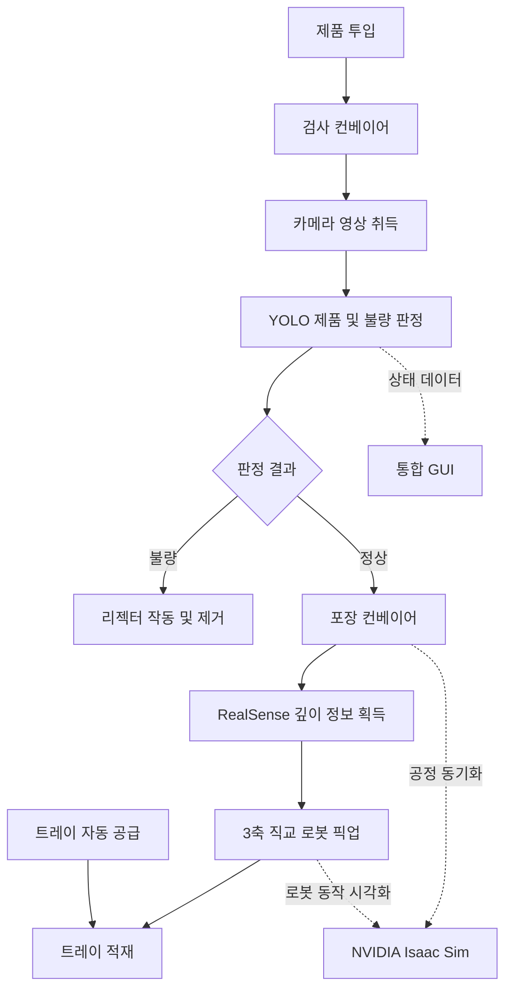

# Virtual to Real 디지털 트윈 기반 물류 적재 공정의 AI 동작 최적화 및 검증

> **2026 한이음 드림업 | 프로젝트 번호: 26_HC278**  
> AI-Based Motion Optimization and Validation of Logistics Loading Processes Using a Virtual-to-Real Digital Twin
---

## 💡 1. 프로젝트 개요

### 1-1. 프로젝트 소개

- **프로젝트명:** Virtual to Real 디지털 트윈 기반 물류 적재 공정의 AI 동작 최적화 및 검증
- **프로젝트 번호:** 26_HC278
- **프로젝트 정의:** AI 비전으로 컨베이어 위의 제품과 불량 여부를 인식하고, 불량 제품은 리젝터로 분리하며, 정상 제품은 깊이 카메라 및 3축 직교 로봇을 활용하여 트레이에 자동 적재하는 시스템입니다. 실제 장치와 NVIDIA Isaac Sim 디지털 트윈을 연동하여 공정 진행 상태를 시각화합니다.

### 1-2. 개발 배경 및 필요성

제조·물류 현장의 제품 검사, 불량 선별 및 적재 작업은 반복적인 공정으로 이루어집니다. 수작업 중심의 방식은 작업 부담이 크고 공정 상태를 지속적으로 파악하기 어렵습니다. 이에 AI 기반 영상 인식과 로봇 자동화 기술을 결합하여 검사부터 분류, 적재까지 이어지는 통합 시스템을 구현하고자 하였습니다.

또한 실제 설비의 동작을 디지털 트윈 환경에서 확인함으로써 공정 흐름을 쉽게 이해하고 모니터링할 수 있도록 구성하였습니다.

### 1-3. 프로젝트 특장점

- **AI 비전 검사:** YOLO 기반 객체 인식으로 제품과 불량 제품을 구분
- **자동 분류:** 검사 결과에 따라 불량 제품을 리젝터로 제거하고 정상 제품만 다음 공정으로 이송
- **자동 적재:** 깊이 카메라로 제품 위치를 파악하고 3축 직교 로봇과 진공 그리퍼로 적재
- **트레이 자동 공급:** 적재 흐름에 맞춰 트레이를 공급하여 공정 연속성 확보
- **디지털 트윈 연동:** NVIDIA Isaac Sim에서 공정 및 장치 동작을 시각화
- **통합 모니터링:** GUI에서 공정 상태와 제품 처리 현황 확인

### 1-4. 주요 기능

| 기능 | 설명 |
| --- | --- |
| 제품 인식 | 카메라 영상에서 YOLO 모델을 이용한 제품 검출 및 추적 |
| 불량 검사 | 검출 결과에 따라 정상/불량 제품 판정 |
| 불량 제거 | 리젝터를 작동시켜 불량 제품을 컨베이어에서 제거 |
| 위치 인식 | Intel RealSense 깊이 정보를 이용한 제품 위치 확인 |
| 자동 적재 | 3축 직교 로봇과 진공 그리퍼를 통한 정상 제품 픽업 및 트레이 적재 |
| 트레이 공급 | 적재 공정에 필요한 트레이 자동 공급 |
| 디지털 트윈 | 실제 공정 상태와 Isaac Sim 시뮬레이션 연동 |
| GUI | 컨베이어 상태, 처리 수량 및 동작 이력 모니터링 |

**전체 공정 흐름**

```text
제품 투입
   ↓
검사 컨베이어 이동
   ↓
카메라 + YOLO 제품/불량 판정
   ├─ 불량 → 리젝터 작동 → 불량 제품 제거
   └─ 정상 → 포장 컨베이어 이동
                    ↓
              깊이 카메라 위치 확인
                    ↓
              3축 직교 로봇 픽업
                    ↓
               트레이 자동 적재
                    ↓
              트레이 공급 및 배출

[공정 상태 → GUI 표시 / NVIDIA Isaac Sim 디지털 트윈 연동]
```

### 1-5. 기대 효과 및 활용 분야

- **기대 효과:** 반복적인 검사·분류·적재 작업 자동화, 공정 흐름의 일관성 향상, 작업 상태의 시각적 확인 및 통합 모니터링
- **활용 분야:** 스마트 팩토리, 제조 품질 검사, 소형 제품 분류 및 물류 자동화, 로봇 기반 공정 실습 및 디지털 트윈 교육

### 1-6. 기술 스택

| 구분 | 사용 기술 및 장치 |
| --- | --- |
| 프로그래밍 | Python, Arduino C/C++ |
| AI 비전 | YOLOv8, OpenCV, 객체 추적 |
| 깊이 센싱 | Intel RealSense |
| 시뮬레이션 | NVIDIA Isaac Sim |
| 로봇 및 장치 | 3축 직교 로봇, 진공 그리퍼, 컨베이어, 리젝터, 트레이 로더 |
| 임베디드 제어 | STM32, OpenRB |
| 통신 | UART(Serial), TCP/IP |
| 모니터링 | Python 기반 통합 GUI |

---

## 👥 2. 팀원 소개 (이름 기재 X)

> **작성 필요:** 아래 역할은 편집용 자리표시자입니다. 실제 팀원 수와 담당 업무에 맞춰 수정해 주세요.

| 멘티 1 | 멘티 2 | 멘티 3 | 멘티 4 | 멘토 |
| --- | --- | --- | --- | --- |
| 담당 역할 입력 | 담당 역할 입력 | 담당 역할 입력 | 담당 역할 입력 | 기술 자문 및 프로젝트 지도 |

---

## 🛠️ 3. 시스템 구성도

### 3-1. 시스템 전체 구조



### 3-2. 하드웨어 구성

- **검사부:** 검사 컨베이어, 카메라, 제품 감지 센서, 리젝터
- **이송부:** 검사 및 포장 컨베이어
- **적재부:** 3축 직교 로봇, 진공 그리퍼, 트레이 로더
- **제어부:** STM32 및 OpenRB 기반 장치 제어
- **센싱부:** Intel RealSense 깊이 카메라

> **이미지 추가 위치:** 실제 구성도 이미지를 `images/system-overview.png` 경로로 업로드한 뒤 아래 줄의 `<!--`와 `-->`를 제거하면 표시됩니다.
>
> ``

### 3-3. 소프트웨어 구성

- **YOLO/OpenCV:** 실시간 제품 인식, 추적 및 검사 결과 처리
- **Python 통합 제어:** 검출 결과와 장치 동작 연계 및 상태 관리
- **UART/TCP 통신:** 장치·프로그램 간 제어 데이터 전달
- **Isaac Sim:** 실물 시스템의 공정 및 동작 시각화
- **GUI:** 주요 공정 상태 및 처리 결과 표시

---

## 🎬 4. 작품 소개영상

> **영상 등록 필요:** 완성된 소개영상의 YouTube 주소를 아래에 추가해 주세요.

- [작품 소개영상 URL 입력](https://www.youtube.com/)

**YouTube 썸네일을 클릭할 수 있도록 등록하는 방법**

```markdown
[](https://www.youtube.com/watch?v=영상ID)
```

**권장 영상 구성:** 제품 인식 → 불량 제거 → 깊이 기반 자동 적재 → 트레이 자동 공급 → Isaac Sim → 전체 동작 → GUI

---

## 💻 5. 핵심 소스코드

현재 저장소에 업로드된 실제 파일에 연결하였습니다. 파일별 세부 설명은 코드 최종본 확인 후 보완할 수 있습니다.

| 파일 | 내용 | 링크 |
| --- | --- | --- |
| `yolo.py` | YOLO 기반 영상 인식 및 검사 관련 코드 | [코드 보기](./yolo.py) |
| `deapth.py` | 깊이 카메라 관련 코드 | [코드 보기](./deapth.py) |
| `master.py` | 통합 시스템 구동 관련 메인 코드 | [코드 보기](./master.py) |
| `openrb3.ino` | OpenRB 기반 장치 제어용 Arduino 스케치 | [코드 보기](./openrb3.ino) |
| `입구 좌표.py` | 위치 및 좌표 처리 관련 코드 | [코드 보기](./%EC%9E%85%EA%B5%AC%20%EC%A2%8C%ED%91%9C.py) |
| `best.pt` | 학습된 객체 인식 모델 가중치 | [파일 보기](./best.pt) |
| `webcam_calibration.npz` | 웹캠 캘리브레이션 데이터 | [파일 보기](./webcam_calibration.npz) |

### 5-1. AI 비전 기반 검사

**관련 코드:** [`yolo.py`](./yolo.py)

제품 영상을 분석하여 제품과 불량 여부를 판정하는 기능입니다. 실시간 인식 결과는 분류 공정 및 후속 장치 제어와 연계됩니다.

### 5-2. 깊이 카메라 기반 위치 인식

**관련 코드:** [`deapth.py`](./deapth.py)

제품 위치 판단에 필요한 깊이 카메라 데이터를 처리하여 정상 제품의 로봇 적재 공정과 연계합니다.

### 5-3. 통합 제어 및 디지털 트윈

**관련 코드:** [`master.py`](./master.py)

검사, 분류, 적재 공정 및 시스템 상태를 통합적으로 처리하고 실제 장치와 디지털 트윈 사이의 동작을 연계하는 핵심 코드입니다.

### 5-4. 임베디드 장치 제어

**관련 코드:** [`openrb3.ino`](./openrb3.ino)

OpenRB 환경의 장치 제어 스케치입니다. 실제 구동을 위한 하드웨어 연결·통신 설정은 실행 환경에 맞게 구성해야 합니다.

---

> **제출 전 확인 사항:** 팀원별 실제 담당 업무 입력, 하드웨어/소프트웨어 구성도 이미지 첨부, 작품 영상 URL 등록, 코드 설명과 실제 최종 구현 내용 일치 여부 점검.
